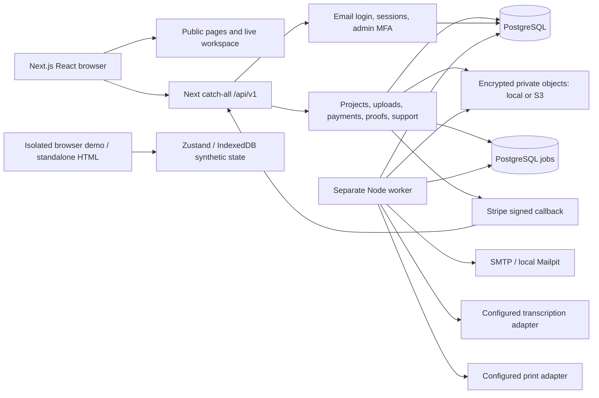

# Actual system architecture

Current GitHub repository, reviewed 14 October 2026. The alternate NestJS source in Downloads is not imported into this runtime.

## Boundaries and data flow

One catch-all API (`src/app/api/v1/[...path]/route.ts:1–10`) dispatches to `src/server/api.ts`. Every private request requires a valid hashed database session. Mutations require an exact Origin match, except the Stripe endpoint, which verifies the raw-body signature. Project role resolution is in `projects.ts`; membership and explicit support grants govern access. A purchase alone does not reveal narrator-private memories.

PostgreSQL stores accounts, sessions, payment metadata, role membership, consent, versioned encrypted project snapshots, uploads, private media metadata, print orders, jobs, rate limits and audit events. AES-256-GCM encrypts project snapshots, media bytes and sensitive job/support payloads with the configured application key. Account emails, project titles, membership metadata and order totals remain plaintext in the database; database/backup access is therefore sensitive.

Uploads are chunked and resumable. Images are decoded and re-encoded with sharp; audio is inspected with ffprobe/ffmpeg with restricted protocols. The narrator previews a PDF; approval binds its content hash and media bytes to a version. Printing dispatches those stored bytes, not a newly rendered mutable manuscript. The supplier contract and physical preflight remain unverified.

Jobs use PostgreSQL leases, deduplication keys, retry backoff and failed states. SMTP, transcription and printer operations execute in the separate worker. These are adapter contracts, not proof of a connected production provider. The local launcher uses PostgreSQL and Mailpit on loopback ports. Hosted deployment has not occurred.

## Architectural risks under review

- Encrypted snapshots simplify privacy and transactional edits, but every save retains another full revision; retention and capacity need explicit bounds.
- Project listing decrypts each book and issues per-project authorization queries; measure before increasing the cohort.
- Media validation and PDF rendering run synchronously within database transactions. Long work can retain locks and connections.
- PostgreSQL is also the queue; worker heartbeat and stale-lease handling need monitoring.
- Shared demo/book models require care: demo-only pricing/preflight/QR routing must not become production claims.
- A single encryption key needs a reviewed rotation/recovery procedure before real family data is hosted.
